# InclusiveMarket — System Diagrams and Specifications

Single reference for architecture, flows, data, UML, requirements, glossary, and technology.

**FigJam board (diagrams generated before the client revision):** [InclusiveMarket diagrams](https://www.figma.com/board/MUqtGs9UgXpJIGFgH6VS0O). The Mermaid diagrams in this file are current; where they differ from the board, this file wins.

Live app: [https://inclumarket.vercel.app](https://inclumarket.vercel.app)

| Section | What it covers |
| --- | --- |
| 1. Architecture | Runtime services and integrations |
| 2. Use cases | Guest, buyer, seller, admin |
| 3. Process flowcharts | Purchase, listing, admin |
| 4. ERD | Commerce, messaging, platform |
| 5. UML | Components, class model, sequences, states |
| 6. Functional requirements | What the system must do |
| 7. Non-functional requirements | Quality attributes |
| 8. Terms and definitions | Domain glossary |
| 9. Technology stack | Languages, libraries, hosting |

FigJam cannot generate UML **use-case ovals** or **class diagrams**. Those are modeled here as a use-case flowchart plus a Mermaid `classDiagram` (renders in GitHub / VS Code). Sequence, state, ER, architecture, and process flows are on the FigJam board.

---

## 1. System architecture

Browser → Vercel (Next.js middleware refreshes the Supabase session) → App
Router pages and server actions → Supabase (Postgres, Auth, Storage). Online
payment goes to PayMongo's hosted checkout and comes back through a signed
webhook. Email goes out over Resend or Brevo's HTTP API. The chatbot is
rule-based unless OpenRouter is configured.

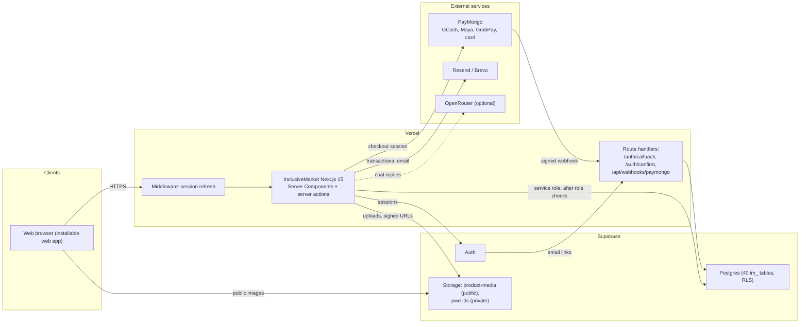

---

## 2. Use cases

Actors: **Guest**, **Buyer**, **Seller**, **Admin**.

```mermaid
flowchart TD
    guest(["Guest"])
    buyer(["Buyer"])
    seller(["Seller"])
    admin(["Admin"])

    subgraph publicUC ["Public"]
        browse["Browse catalog"]
        viewP["View product"]
        chat["Use chatbot"]
        a11y["Accessibility tools"]
        login["Sign in or sign up"]
    end

    subgraph buyerUC ["Buyer"]
        cart["Cart and wishlist"]
        checkout["Checkout order"]
        track["Track orders"]
        review["Review product"]
        msgB["Message seller"]
    end

    subgraph sellerUC ["Seller"]
        listP["List products"]
        fulfill["Fulfill orders"]
        payout["Request payout"]
        msgS["Message buyer"]
        verifyS["Verify PWD ID"]
    end

    subgraph adminUC ["Admin"]
        users["Manage users"]
        moderate["Moderate products"]
        tickets["Resolve tickets"]
        reports["Export reports"]
        verifyA["Review PWD IDs"]
        disputes["Settle returns, record refunds"]
    end

    guest --> browse
    guest --> viewP
    guest --> chat
    guest --> a11y
    guest --> login
    login --> buyer
    login --> seller
    login --> admin
    buyer --> browse
    buyer --> cart
    buyer --> checkout
    buyer --> track
    buyer --> review
    buyer --> msgB
    seller --> listP
    seller --> fulfill
    seller --> payout
    seller --> msgS
    seller --> verifyS
    buyer --> verifyS
    admin --> verifyA
    admin --> disputes
    admin --> users
    admin --> moderate
    admin --> tickets
    admin --> reports
```

### Use-case inventory

| ID | Actor | Use case | Route / action |
| --- | --- | --- | --- |
| UC-01 | Guest | Browse catalog, search, filter | `/home` |
| UC-02 | Guest | View product detail | `/buyer/product/[id]` |
| UC-03 | Guest | Use floating chatbot | `ChatWidget` |
| UC-04 | Guest | Adjust accessibility prefs | a11y toolbar + `im_ui_prefs` |
| UC-05 | Guest | Sign up / sign in | `/login`, `/auth/callback` |
| UC-06 | Buyer | Cart, wishlist, checkout | `/buyer/cart`, `/buyer/checkout` |
| UC-07 | Buyer | Track orders | `/buyer/orders` |
| UC-08 | Buyer | Review a product | product page |
| UC-09 | Buyer | Message a seller | `/buyer/messages` |
| UC-10 | Buyer | Open a support ticket | `/buyer/support` |
| UC-11 | Seller | Create / edit products and variants | `/seller/products` |
| UC-12 | Seller | Fulfill orders (processing → shipped → delivered) | `/seller/orders` |
| UC-13 | Seller | View reviews | `/seller/reviews` |
| UC-14 | Seller | See earnings and request a payout | `/seller/finance` |
| UC-15 | Admin | Manage users and account status | `/admin/users` |
| UC-16 | Admin | Moderate products (approve / flag) | `/admin/products` |
| UC-17 | Admin | Resolve tickets | `/admin/tickets` |
| UC-18 | Admin | Export Excel reports | `/admin/reports` |
| UC-19 | Admin | Check payment status (read-only) | `/admin/payments` |
| UC-20 | Admin | Customize theme tokens | `/admin/theme` |
| UC-21 | Admin | Answer privacy requests and contact messages; audit trail | `/admin/compliance` |
| UC-22 | Buyer, Seller | Verify PWD ID (upload or camera) | `/account/verification` |
| UC-23 | Admin | Approve, reject, revoke PWD verifications; resolve duplicate flags | `/admin/verifications` |
| UC-24 | Admin | Settle returns, cancel orders, record refunds | `/admin/orders` |
| UC-25 | Admin | Approve and pay seller payouts | `/admin/payouts` |
| UC-26 | Admin | Categories, review hiding, homepage banners | `/admin/categories`, `/admin/reviews`, `/admin/banners` |
| UC-27 | Admin | PWD discount rules with legal sign-off; settings | `/admin/discounts`, `/admin/settings` |
| UC-28 | Seller | Shop settings, flash sales, packing slips, support | `/seller/shop`, `/seller/flash-sales`, `/seller/orders`, `/seller/support` |
| UC-29 | Any user | Addresses, notification choices, privacy requests | `/account/*` |
| UC-30 | Guest | Contact form | `/contact` |

---

## 3. Process flowcharts

### 3.1 Buyer purchase

```mermaid
flowchart LR
    start(["Open /home or /search"]) --> product["Product page"]
    product --> signedIn{"Signed in?"}
    signedIn -->|"No"| login["Sign in"] --> cart
    signedIn -->|"Yes"| cart["Cart: choose items"]
    cart --> checkout["Checkout: address, payment"]
    checkout --> price["Pricing engine: flash sale →<br/>PWD rule (verified only) → weekly cap →<br/>₱60 shipping per seller"]
    price --> stock{"Stock reserved?"}
    stock -->|"No"| fail["Explain which item"] -.-> cart
    stock -->|"Yes"| split["One checkout, one order per seller"]
    split --> pay{"Payment"}
    pay -->|"Cash on delivery"| placed["Orders pending; sellers notified"]
    pay -->|"PayMongo"| hosted["PayMongo hosted page"]
    hosted --> webhook["Signed webhook marks paid"]
    webhook --> placed
    hosted -.->|"abandoned"| release["Hold expires; stock released"]
    placed --> done(["Track each order"])
```

### 3.2 Seller listing and fulfillment

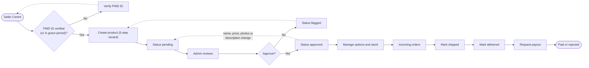

### 3.3 Admin console

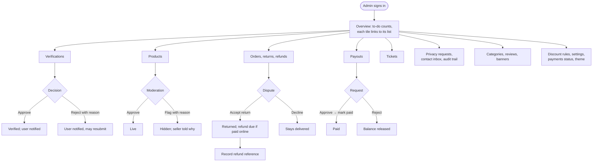

### 3.4 PWD verification

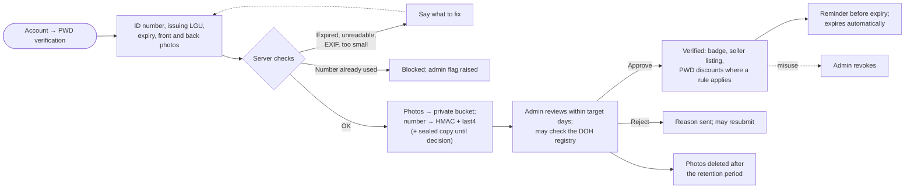

### 3.5 Returns and refunds

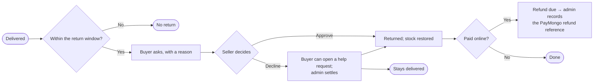

---

## 4. Entity-relationship diagrams

The diagrams below cover the original tables. The tables and columns added by migrations 0013–0024 (checkouts, PWD verification, discount rules, addresses, banners, privacy requests, contact inbox, settings) are in **[docs/erd.md](erd.md)**.

Tables use the `im_` prefix (shared Supabase project with InkluTrack). Profiles link to `auth.users` via `auth_user_id`. Full column lists: `docs/erd.md` and migrations `0001`–`0008`.

### 4.1 Commerce

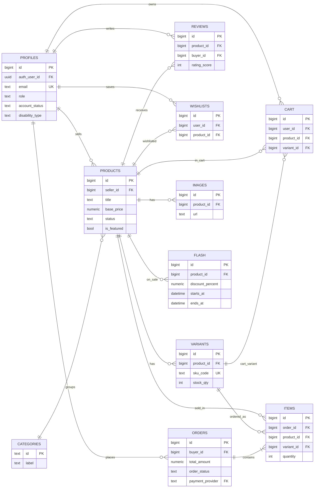

### 4.2 Messaging and support

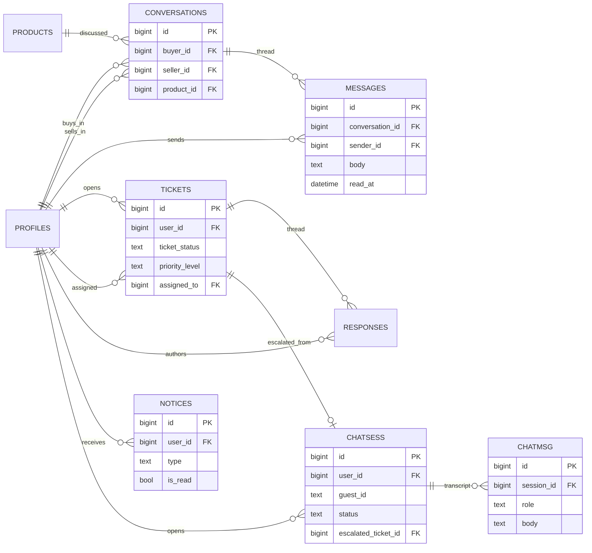

### 4.3 Platform, payments, accessibility

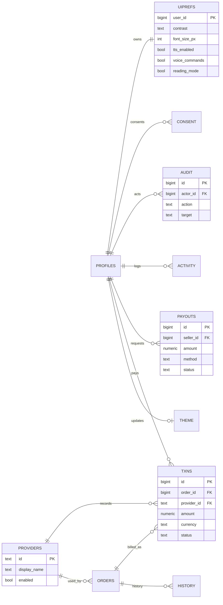

Also: `im_theme_settings` (singleton theme), `im_newsletter_subscribers`, view `im_low_stock_alerts`.

---

## 5. UML

### 5.1 Component layers

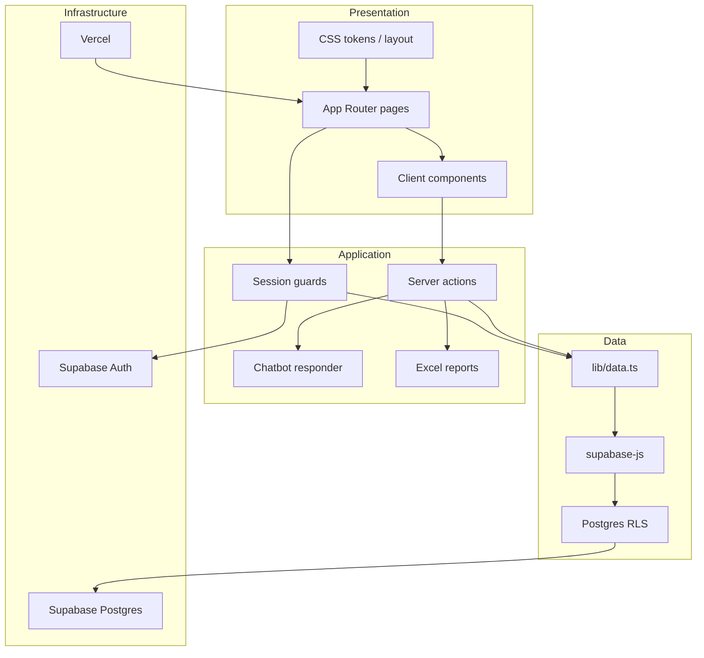

### 5.2 Class diagram (domain)

Not generated in FigJam (unsupported type). Renders in this file.

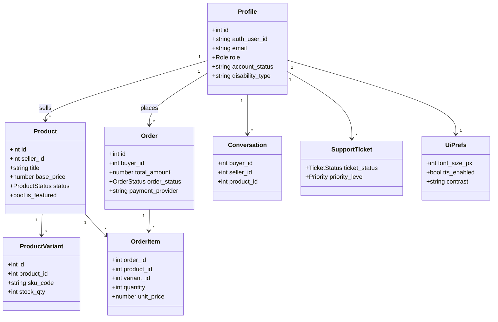

**Enums (from `lib/types.ts` and migrations):**

| Type | Values |
| --- | --- |
| `Role` | `buyer` \| `seller` \| `admin` |
| `ProductStatus` | `pending` \| `approved` \| `flagged` |
| `OrderStatus` | `pending` \| `processing` \| `shipped` \| `delivered` \| `returned` |
| `TicketStatus` | `open` \| `in_progress` \| `resolved` |
| `account_status` | `active` \| `suspended` \| `pending_approval` |
| `payout.status` | `requested` \| `approved` \| `paid` \| `rejected` |
| `transaction.status` | `pending` \| `paid` \| `failed` \| `refunded` |
| Chat session | `open` \| `escalated` \| `closed` |

### 5.3 Sequence — sign in

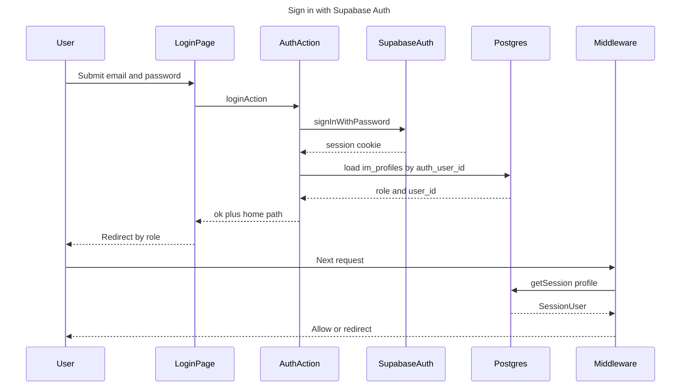

Homes: buyer → `/home`, seller → `/seller/dashboard`, admin → `/admin/users`.

### 5.4 Sequence — checkout

```mermaid
sequenceDiagram
    title Buyer checkout (one checkout, one order per seller)
    participant Buyer
    participant Checkout as Checkout page
    participant Action as shop.ts placeOrder
    participant Engine as Pricing engine
    participant Postgres
    participant PayMongo
    participant Webhook as /api/webhooks/paymongo

    Buyer->>Checkout: Choose items, address, payment
    Checkout->>Action: placeOrder(selection, address, method)
    Action->>Engine: priceCartForBuyer
    Engine->>Postgres: Lines, flash sales, verified PWD, rules, weekly cap
    Engine-->>Action: Priced lines, per-seller groups, totals
    Action->>Postgres: Create checkout + orders + items, reserve stock (one transaction)
    alt Cash on delivery
        Action-->>Checkout: Orders placed
        Action->>Postgres: Notify each seller
    else PayMongo
        Action->>PayMongo: Create checkout session (exact same totals)
        PayMongo-->>Buyer: Hosted payment page
        PayMongo->>Webhook: checkout_session.payment.paid (signed)
        Webhook->>Postgres: Verify signature, mark checkout and orders paid (idempotent)
        Webhook->>Postgres: Notify sellers; queue receipt email
    end
```

### 5.5 Sequence — messaging

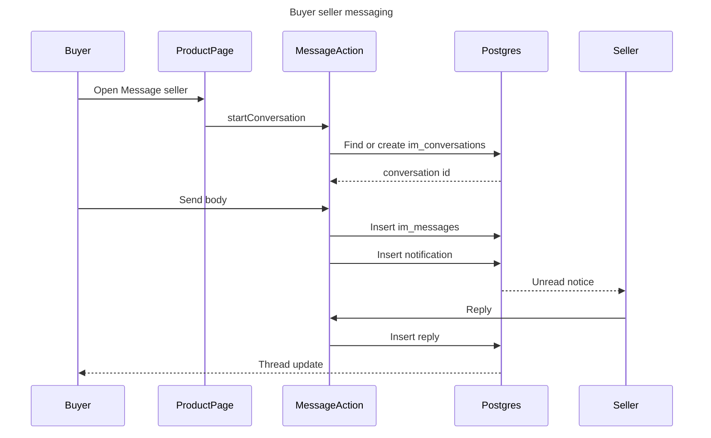

### 5.6 State machines

**Order**

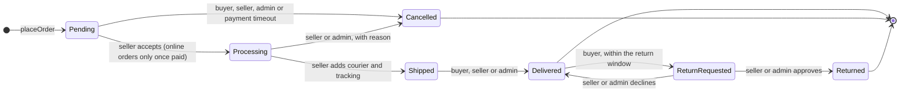

**Product**

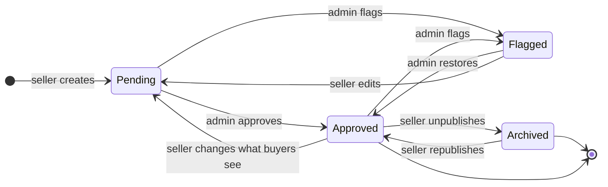

**Support ticket**

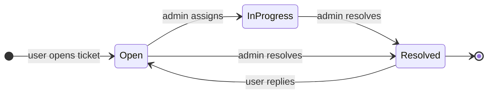

**Account**

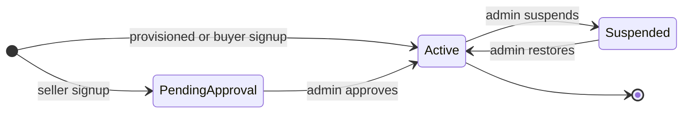

**Seller payout**

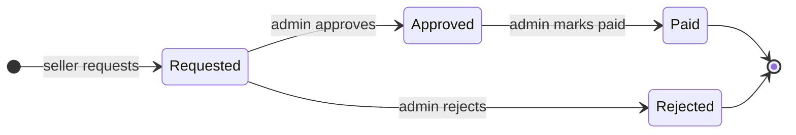

---

## 6. Functional requirements

| ID | Requirement | Source in code |
| --- | --- | --- |
| FR-01 | Users authenticate with email/password via Supabase Auth; unconfirmed signups must confirm email. | `lib/actions/auth.ts` |
| FR-02 | Role-based homes and route guards for buyer, seller, admin. | `lib/session.ts`, middleware |
| FR-03 | Guests and any role may view the public catalog and product pages. | `/home`, `/buyer/product/[id]` |
| FR-04 | Buyers add variants to a server-side cart, choose which lines to buy, and check out; one checkout becomes one order per seller, with stock reserved in the same transaction. | `lib/actions/cart.ts`, `shop.ts`, `im_checkouts` |
| FR-05 | Payment by cash on delivery or PayMongo (GCash, Maya, GrabPay, card); a signed, idempotent webhook marks orders paid. Status follows a database-enforced state machine with history. | `lib/payments/`, `lib/orders/`, `0014` |
| FR-06 | Buyers who received a product rate it 1–5 with an optional comment; sellers reply; admins hide a review with a reason. | `im_product_reviews`, `/admin/reviews` |
| FR-07 | Buyers and sellers message per conversation (unique buyer+seller pair). | `im_conversations`, `im_messages` |
| FR-08 | Floating chatbot works for guests and users; sessions can escalate to a support ticket. | `ChatWidget`, `im_chat_sessions` |
| FR-09 | Buyers and sellers open help requests and reply; admins reply and resolve; both sides are notified. | `/buyer/support`, `/seller/support`, `/admin/tickets` |
| FR-10 | Sellers create products (pending until admin approval) with variants, images, and stock. | `/seller/products` |
| FR-11 | Sellers advance order status along the allowed path. | `/seller/orders` |
| FR-12 | Admins work from an overview of to-dos: moderate listings (with reasons), verify PWD IDs, settle returns and record refunds, approve payouts, manage users, categories, banners, discount rules, settings and the theme. Payments is read-only status. | `/admin/*` |
| FR-13 | Admins export `.xlsx` reports (users, products, orders, reviews, tickets, audit, or full). | `lib/reports/excel.ts` |
| FR-14 | Accessibility toolbar: font size, contrast, TTS, voice commands, reading mode, reduced motion, visual alerts. | `lib/a11y/prefs.ts`, `im_ui_prefs` |
| FR-15 | In-app notifications for low stock, orders, shipping, reviews, flash sales, messages, chat escalation. | `im_notifications` |
| FR-16 | Flash sales with percent discount and start/end window, one live sale per product; wishlisting buyers are notified. | `im_flash_sales`, `0024` |
| FR-17 | Consent and audit logs for compliance. | `im_consent_logs`, `im_audit_logs` |
| FR-18 | Newsletter subscribe and token unsubscribe; admin list and CSV export. | `im_newsletter_subscribers`, `/admin/newsletter` |
| FR-19 | Truthful static pages; contact form for guests and users into an admin inbox. | `app/about` etc., `im_contact_messages` |
| FR-20 | Seller earnings and payout requests (minimum and fee from settings); admin approve, mark paid, reject. | `im_payouts`, `im_seller_earnings` |
| FR-21 | PWD ID verification: upload or camera capture, duplicate-number block, admin decision with reasons, expiry, revocation, image retention. | `lib/pwd/`, `/account/verification`, `/admin/verifications` |
| FR-22 | PWD discounts only through enabled rules with a legal basis and sign-off, only for verified buyers, with the weekly cap where it applies. | `lib/pricing/`, `im_discount_rules` |
| FR-23 | Search with typo tolerance, category and PWD-friendly-feature filters, sort, and paging. | `lib/storefront.ts`, `/search` |
| FR-24 | Saved addresses, notification preferences per type, recommendation opt-out, data-subject requests. | `/account/*` |
| FR-25 | Installable web app (manifest and icons; no offline mode). | `public/manifest.webmanifest` |

---

## 7. Non-functional requirements

| ID | Category | Requirement |
| --- | --- | --- |
| NFR-01 | Accessibility | Aim WCAG 2.2 AA; usable at 24 px root font and 320 px width; no drag-only interactions; 44 px targets; reduced motion honoured from the OS and the toolbar. |
| NFR-02 | Security | Every server action checks the caller before the service-role client (guard audit in `verify`); RLS on all `im_*` tables and no client writes with the public key (0013); rate limits on public endpoints. |
| NFR-03 | Privacy | Emails masked in cross-role UI and Excel exports; consent logs; no service-role in the browser bundle. |
| NFR-04 | Internationalization | Currency ISO 4217 `PHP`; timestamps ISO 8601 UTC in reports; `en-PH` date formatting in UI. |
| NFR-05 | Performance | Storefront reads from a pre-computed view with paging; images resized on the device and served from Storage (≤1 MB). |
| NFR-06 | Availability | Production on Vercel; Supabase managed Postgres + Auth. |
| NFR-07 | Maintainability | `tsc --strict` as the lint gate; `npm run verify` (checks, unit tests, PGlite migration tests) must pass before a change lands; every migration from 0013 has a rollback. |
| NFR-08 | Auditability | Every admin/seller/buyer mutation can write `im_audit_logs`; reports include an audit sheet. |
| NFR-09 | Usability | Blue and brown palette (red only for danger) with contrast checked in CI; plain-language copy; toasts that wait and can be paused. |
| NFR-10 | Integrity | Stock checks at checkout; FK `ON DELETE` cascade or set-null as documented in `docs/erd.md`; payout/transaction amount checks. |
| NFR-11 | Compatibility | Modern evergreen browsers; responsive web app, installable on phones; no native app. |
| NFR-12 | Observability | Activity feed (`im_activity_logs`) plus Vercel deployment logs. |

---

## 8. Terms and definitions

| Term | Definition |
| --- | --- |
| **InclusiveMarket** | PWD-livelihood marketplace in the InkluTrack ecosystem (this Next.js + Supabase app). Older spellings survive only in internal identifiers. |
| **AVRC Region IX** | Area Vocational Rehabilitation Center, Zamboanga Peninsula — trains the PWD sellers and runs the admin console. |
| **PWD** | Person with disability. A PWD verification (`im_pwd_verifications`) is the single source of "verified" (`im_verified_pwd`). |
| **PWD discount rule** | Configuration for a discount (RA 10754 20%, DTI-DA JMC 01-2022 BNPC 5%, or voluntary) — off until a legal sign-off. |
| **Checkout** | One payment covering one order per seller (`im_checkouts`). |
| **DSWD** | Department of Social Welfare and Development (Philippines). Brand colors: blue (primary), red (compassion), yellow/gold (hope), white (background). |
| **Buyer / Seller / Admin** | The three `im_profiles.role` values. Admin is not available via public signup. |
| **Guest** | Unauthenticated visitor; may browse, use chatbot, and adjust local a11y prefs. |
| **RLS** | Row Level Security — Postgres policies; defense in depth under server-action role checks. |
| **Server action** | Next.js `"use server"` function in `lib/actions/*`; never throws to the UI — returns `{ ok, error }`. |
| **Service role** | Supabase key that bypasses RLS. Used only on the server (`createAdminClient`). |
| **Publishable / anon key** | Public Supabase key; access still limited by RLS. |
| **Variant** | Sellable SKU of a product (`color_name`, `size`, `stock_qty`, `sku_code`). |
| **Flash sale** | Time-bounded percent discount on a product. |
| **Chat session** | Bot transcript (`im_chat_sessions`); may escalate to `im_support_tickets`. |
| **Conversation** | Direct buyer–seller thread, optionally tied to a product. |
| **Payout** | Seller withdrawal request (bank / GCash / Maya / PayPal / other). |
| **Transaction** | Ledger row for an order payment (`im_transactions`). |
| **WCAG 2.2 AA** | Web Content Accessibility Guidelines level AA — target for UI. |
| **TTS** | Text-to-speech in the accessibility toolbar. |
| **ISO 8601 / ISO 4217** | Date-time and currency codes used in Excel reports. |
| **Vercel** | Hosting and CDN for the production Next.js app. |
| **Supabase** | Postgres, Auth and Storage (`product-media` public, `pwd-ids` private). |

---

## 9. Technology stack

### Runtime and UI

| Layer | Technology | Version / notes |
| --- | --- | --- |
| Language | TypeScript | ^5.7 |
| UI | React | ^19 |
| Framework | Next.js App Router | ^15 (Turbopack in `dev`) |
| Styling | Hand-authored CSS | `styles/tokens.css`, `layout.css`, `components.css`, `landing.css` |
| Icons | Custom SVG `Icon` + Font Awesome | FA 7.x for selected glyphs |
| Hosting | Vercel | Project `inclumarket` — https://inclumarket.vercel.app |

### Data and auth

| Layer | Technology | Notes |
| --- | --- | --- |
| Database | PostgreSQL (Supabase) | `im_*` schema, migrations `0001`–`0024`; PGlite for migration tests |
| Auth | Supabase Auth | Cookie session via `@supabase/ssr` |
| Client | `@supabase/supabase-js` | Server + admin (service role) clients |
| Security | RLS + `im_current_profile_role()` | Policies from `0002`; client writes revoked in `0013` |

### Libraries and standards

| Purpose | Technology |
| --- | --- |
| Excel reports | `exceljs` ^4.4 — OOXML `.xlsx` |
| Money | PHP, ISO 4217 |
| Dates | ISO 8601 UTC in exports; `en-PH` in UI |
| Chatbot | Rule-based `lib/chatbot/responder.ts` (pluggable `CHAT_PROVIDER`) |
| Payments | PayMongo Checkout Sessions (GCash, Maya, GrabPay, card) with a signed webhook |
| Accessibility | CSS + `im_ui_prefs` + Web Speech API (TTS / voice) |
| Images | Supabase Storage via `lib/media.ts` (product, shop, banner) and the private `pwd-ids` bucket |
| Email | Resend or Brevo HTTP API; templates in `lib/email/templates.ts` |

### Environment variables

| Name | Scope |
| --- | --- |
| `NEXT_PUBLIC_SUPABASE_URL` | Public |
| `NEXT_PUBLIC_SUPABASE_PUBLISHABLE_KEY` | Public |
| `NEXT_PUBLIC_SITE_URL` | Public (Vercel URL in production) |
| `SUPABASE_SERVICE_ROLE_KEY` | Server only |
| `PWD_ID_HASH_KEY`, `PWD_ID_ENC_KEY` | Server only — required in production |
| `RATE_LIMIT_SALT` | Server only |
| `PAYMONGO_SECRET_KEY`, `PAYMONGO_WEBHOOK_SECRET`, `PAYMONGO_ENV` | Server only |
| `EMAIL_*`, `RESEND_API_KEY`, `BREVO_API_KEY` | Server only |
| `CHAT_PROVIDER`, `OPENROUTER_*` | Optional |
| `NEXT_PUBLIC_CONTACT_*`, `NEXT_PUBLIC_FACEBOOK_URL`, `NEXT_PUBLIC_INSTAGRAM_URL` | Public, optional |

The full list with explanations is in `.env.example`.

### Repository layout (diagram-relevant)

```
app/                 Pages (buyer, seller, admin, static, auth)
components/          Client widgets (header, chat, a11y, cards)
lib/actions/         Server mutations
lib/data.ts …        Reads (server-only DTO shaping)
lib/pricing/         One pricing engine for cart, checkout, PayMongo and orders
lib/orders/          Order state machine
lib/pwd/             PWD verification
lib/reports/excel.ts Report workbooks
lib/a11y/            Accessibility prefs
lib/chatbot/         Bot responder
supabase/migrations/ Schema + RLS
docs/                This file, erd.md, REBUILD_PLAN.md
```

---

## FigJam diagram index

Open the board, then arrange sections if they overlap: [https://www.figma.com/board/MUqtGs9UgXpJIGFgH6VS0O](https://www.figma.com/board/MUqtGs9UgXpJIGFgH6VS0O)

1. System Architecture  
2. Use Cases  
3. Buyer Purchase Flow  
4. Seller Listing and Fulfillment  
5. Admin Moderation Flow  
6. ERD Commerce Domain  
7. ERD Messaging and Support  
8. ERD Platform Payments A11y  
9. Sequence Sign In  
10. Sequence Checkout  
11. Sequence Messaging  
12. State Order Lifecycle  
13. State Product Moderation  
14. State Support Ticket  
15. State Account Status  
16. State Seller Payout  
17. UML Component Layers  

Suggested board layout: **left** architecture + use cases; **center** process flows + sequences; **right** ERDs; **bottom** state machines. Drag sections in FigJam if generation stacked them.
