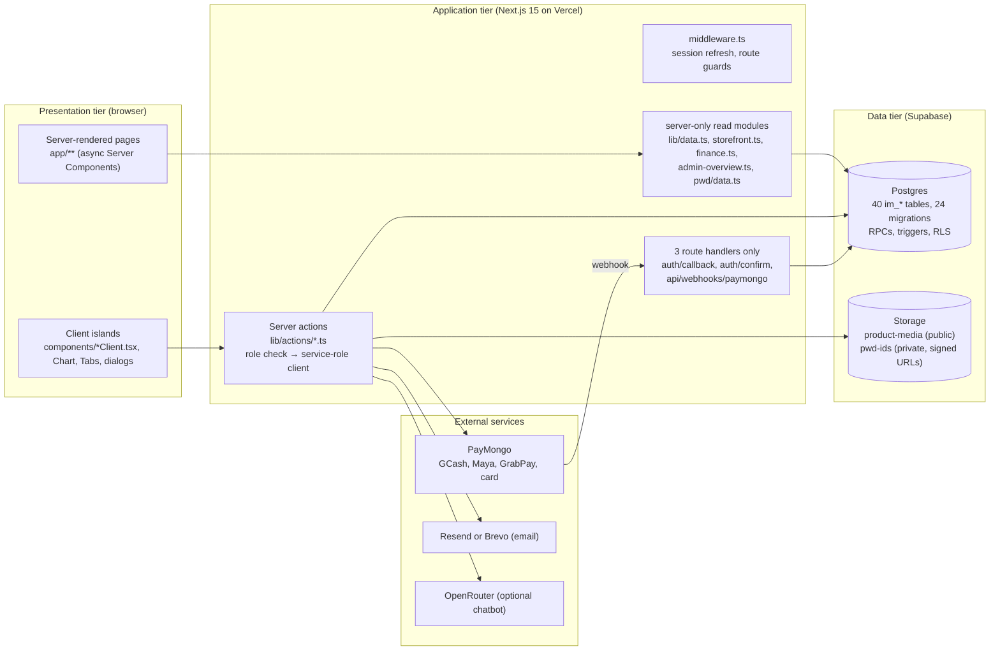

# 02: Architecture and design principles

The brief describes online shopping systems in general: five design
principles, the core functional elements, and two architecture models
(three-tier and microservices). This file maps each of those onto
InclusiveMarket **as it is built**, so the agent extends the real system
instead of the textbook one.

## 1. The architecture in one picture

InclusiveMarket is a **modular monolith in three tiers**, deployed on Vercel
with a managed Supabase backend.



| Brief's tier | In this repo |
|---|---|
| Presentation layer | Server-rendered pages plus small client components; hand-written CSS in `styles/`; PWA manifest |
| Middle / application layer | Server Components for reads, server actions for writes, three route handlers. No REST API of our own |
| Data layer | Supabase Postgres (relational) and Supabase Storage |

## 2. Why not microservices

The brief's second model (API gateway, separate catalog, cart, inventory,
order and payment services, Kafka, Redis, Elasticsearch, CDN) solves
problems this project does not have: thousands of requests per second,
many teams deploying independently, and catalogues of millions of SKUs.
InclusiveMarket serves PWD trainees of one regional centre and their
customers, is maintained by a student team, and runs on Vercel plus
Supabase. Splitting it would add network failure modes, distributed
transactions and hosting cost without a user-visible gain.

Each high-scale idea already has a right-sized substitute:

| High-scale component | What InclusiveMarket does instead | Where |
|---|---|---|
| API gateway | Next.js routing + `middleware.ts` + role checks in every action | `middleware.ts`, `lib/session.ts` |
| Separate order / inventory / payment services | One Postgres with transactional functions | `im_place_checkout`, `im_transition_order`, `im_decrement_variant_stock` / `im_restore_variant_stock` |
| Kafka / message broker | Status history rows + in-app and email notifications written in the same action; throttled sweeps on page load for time-based work (no cron on this deployment) | `im_order_status_history`, `lib/notify.ts`, `lib/pwd/sweep.ts`, `lib/payments/stock.ts` |
| Elasticsearch | Postgres full-text search (`tsvector`, `simple` config because listings mix English and Filipino) plus `pg_trgm` fuzzy matching | migration `0016` |
| Redis cache | Denormalised counters on products (rating, sold, stock) refreshed by functions; every page renders fresh (`force-dynamic`) | migration `0016` |
| CDN for media | Vercel's edge for static assets; Supabase Storage public bucket for product photos | `lib/media.ts` |

**Rule for this build:** do not introduce a queue, a cache server, a search
engine or a second backend. If a dashboard query is slow, add an index or a
SQL function in a new migration first.

## 3. The five design principles, mapped

| Principle (from the brief) | How the system meets it today | What this build must preserve or add |
|---|---|---|
| **Security**: protect credentials, personal data and payments | Supabase Auth; every server action checks the role before using the service-role client; RLS guards the browser-key PostgREST surface; PayMongo hosted checkout so card data never touches our servers; PWD ID photos in a private bucket, read only through 60-second signed URLs, with hashed and encrypted ID numbers; magic-byte image checks, EXIF refused; rate limiting; a Content-Security-Policy from `next.config.mjs`; audit log `im_audit_logs` | New dashboard reads stay in `server-only` modules and return aggregates, never rows with emails or addresses. Admin pages call `requireRole(["admin"])`, seller pages `requireRole(["seller"])` and scope every query to the session's own id. Any new server action goes through the `security-reviewer` subagent |
| **Integrity**: orders, stock and payments complete fully or roll back | Checkout is one Postgres function (`im_place_checkout`) that splits a cart into one order per seller; order status changes only through `im_transition_order`, guarded by a trigger; stock is reserved and restored by functions; unpaid online orders expire and give stock back; payouts are requested through `im_request_payout` | Dashboards are read-only. Metrics must use the same "counted order" rule everywhere (`03` §4), so admin GMV, seller revenue and finance balances agree |
| **Stability and availability** | Managed hosting (Vercel, Supabase); every data page has loading, error and empty states; a feature whose migration is missing degrades and says which migration it needs (`isMissingObject`) | Every new widget handles "table missing" (show "—" and "Needs a database update") and "no data yet" (designed empty state) separately. One failing widget must not take the page down: catch per widget |
| **Simplicity and usability** | Mobile-first, one navigation source (`lib/nav.ts`), plain-language seller copy, accessibility toolbar (12–24px text, high contrast, reduced motion, large cursors, read-aloud), WCAG 2.1 AA target, SUS ≥ 70 target in the proposal | Fewer, larger numbers on dashboards; every number links to the list behind it; no hover-only information; tables become cards on phones |
| **Timeliness (low latency)** | Pages render on request, so prices, stock and statuses are current; aggregates read with `count: "exact", head: true` or bounded windows; P95 < 2.5s target in the proposal | Aggregate in SQL or on the server over bounded windows (30 days, 12 weeks), never "read every order". If a widget needs more than one round trip per card, combine the reads with `Promise.all`, as `lib/admin-overview.ts` does |

## 4. Functional elements, mapped

| Element (from the brief) | Where it lives | Status |
|---|---|---|
| Product catalogue and search | `/home`, `/search`, `/shop/[sellerId]`, `/buyer/product/[id]`; `lib/storefront.ts` | Exists. Restyle per `05` |
| Cart and checkout | `/buyer/cart`, `/buyer/checkout`; `CartClient`, `CheckoutClient`; `lib/actions/shop.ts` | Exists. No change in this build |
| Accounts and personalisation | `/account/*`, wishlist, recommendations (`lib/recommend.ts`), synced accessibility preferences | Exists. Buyer overview becomes a dashboard per `05` |
| Payments | PayMongo (`lib/payments/*`), COD; webhook route | Exists. Admin payments page stays read-only |
| Admin and inventory dashboard | `/admin/*` (17 pages), `/seller/*` (9 pages) | Exists. Redesign per `03` and `04` |

## 5. How a dashboard widget is built

```
app/admin/page.tsx  (Server Component, requireRole(["admin"]))
   └─ await getAdminAnalytics()          lib/admin-analytics.ts  ("server-only")
         └─ Supabase queries / RPC        bounded window, aggregates only
   └─ <KpiCard …/> <Chart …/>             DTO props: numbers, labels, hrefs
```

- Proposed new modules: `lib/admin-analytics.ts` and
  `lib/seller-analytics.ts`, both `import "server-only"`. Keep
  `lib/admin-overview.ts` for the queue counts it already serves.
- If an aggregate is heavy, prefer one SQL function in a new migration
  (`0025_dashboard_analytics.sql`) over pulling rows into JavaScript. Follow
  the grant pattern in `0012_function_grants.sql` and `0013_surface_b_lockdown.sql`
  so the browser key cannot call it, and add the rollback file.
- Before adding an index, check whether one exists; `im_orders` already has
  indexes on `buyer_id` and `payment_status`. Likely candidates:
  `im_orders(created_at)` and `im_orders(seller_id, created_at)`.
- Time windows use Asia/Manila day boundaries.

## 6. Role surfaces

| Role | Home | Route prefix | Navigation |
|---|---|---|---|
| Guest | `/home` | `/home`, `/search`, `/shop`, `/buyer/product`, static pages | `NAV.guest` |
| Buyer | `/home` | `/buyer/*`, `/account/*` | `NAV.buyer` |
| Seller (PWD trainee) | `/seller/dashboard` | `/seller/*`, `/account/*` | `NAV.seller` (sidebar from lg) |
| Admin (AVRC staff) | `/admin` | `/admin/*`, `/account/*` | `NAV.admin` (sidebar from lg) |

Do not add routes for Apex pages that are out of scope (see `00` §10).
