# InclusiveMarket — Entity Relationship Diagram

All InclusiveMarket tables are namespaced with an `im_` prefix because the Supabase
project is shared with the wider InkluTrack ecosystem (avoids collisions with an
existing `public.profiles` / `public.orders`). Profiles link to Supabase Auth via
`auth_user_id`. Cart lines live in `im_cart_items`.

```mermaid
erDiagram
    im_profiles ||--o{ im_cart_items       : "owns (user_id)"
    im_profiles ||--o{ im_products         : "sells (seller_id)"
    im_profiles ||--o{ im_orders           : "places (buyer_id)"
    im_profiles ||--o{ im_product_reviews  : "writes (buyer_id)"
    im_profiles ||--o{ im_support_tickets  : "opens (user_id)"
    im_profiles ||--o{ im_support_tickets  : "assigned (assigned_to)"
    im_profiles ||--o{ im_ticket_responses : "authors (author_id)"
    im_profiles ||--o{ im_consent_logs     : "consents (user_id)"
    im_profiles ||--o{ im_audit_logs       : "acts (actor_id)"
    im_profiles ||--o| im_theme_settings   : "updates (updated_by)"
    im_profiles ||--o| im_ui_prefs         : "owns (user_id)"

    im_categories ||--o{ im_products        : "groups (category)"

    im_products ||--o{ im_product_variants : "has (product_id)"
    im_products ||--o{ im_product_images   : "has (product_id)"
    im_products ||--o{ im_product_reviews  : "receives (product_id)"
    im_products ||--o{ im_order_items      : "sold in (product_id)"
    im_products ||--o{ im_cart_items       : "in cart (product_id)"

    im_product_variants ||--o{ im_order_items : "ordered as (variant_id)"
    im_product_variants ||--o{ im_cart_items  : "cart variant (variant_id)"

    im_orders ||--o{ im_order_items : "contains (order_id)"

    im_support_tickets ||--o{ im_ticket_responses : "thread (ticket_id)"

    im_profiles {
        bigint  id PK
        uuid    auth_user_id FK "auth.users(id), unique"
        text    name
        text    email UK
        text    role "CHECK buyer|seller|admin"
        text    disability_type
        text    assistive_needs
        timestamptz created_at
        timestamptz updated_at
    }

    im_categories {
        text id PK
        text label
        text folder
    }

    im_products {
        bigint  id PK
        bigint  seller_id FK "im_profiles ON DELETE CASCADE"
        text    title
        text    description
        numeric base_price "CHECK >= 0"
        text    category FK "im_categories ON DELETE SET NULL"
        text    image "emoji fallback"
        text    status "CHECK pending|approved|flagged"
        timestamptz created_at
        timestamptz updated_at
    }

    im_product_variants {
        bigint  id PK
        bigint  product_id FK "im_products ON DELETE CASCADE"
        text    color_name
        text    size
        integer stock_qty "CHECK >= 0"
        text    sku_code UK
    }

    im_product_images {
        bigint  id PK
        bigint  product_id FK "im_products ON DELETE CASCADE"
        text    url
        integer position
    }

    im_orders {
        bigint  id PK
        bigint  buyer_id FK "im_profiles ON DELETE CASCADE"
        numeric total_amount "CHECK >= 0"
        text    order_status "CHECK pending|processing|shipped|delivered|returned"
        timestamptz created_at
    }

    im_order_items {
        bigint  id PK
        bigint  order_id FK "im_orders ON DELETE CASCADE"
        bigint  product_id FK "im_products ON DELETE SET NULL"
        bigint  variant_id FK "im_product_variants ON DELETE SET NULL"
        integer quantity "CHECK > 0"
        numeric unit_price "CHECK >= 0"
    }

    im_product_reviews {
        bigint  id PK
        bigint  product_id FK "im_products ON DELETE CASCADE"
        bigint  buyer_id FK "im_profiles ON DELETE CASCADE"
        integer rating_score "CHECK 1..5"
        text    comment_text
        timestamptz created_at
    }

    im_support_tickets {
        bigint  id PK
        bigint  user_id FK "im_profiles ON DELETE CASCADE"
        text    subject
        text    description_narrative
        text    ticket_status "CHECK open|in_progress|resolved"
        text    priority_level "CHECK low|medium|high"
        bigint  assigned_to FK "im_profiles ON DELETE SET NULL"
        timestamptz created_at
        timestamptz updated_at
    }

    im_ticket_responses {
        bigint  id PK
        bigint  ticket_id FK "im_support_tickets ON DELETE CASCADE"
        text    author_role "CHECK buyer|seller|admin"
        bigint  author_id FK "im_profiles ON DELETE SET NULL"
        text    message
        timestamptz created_at
    }

    im_consent_logs {
        bigint  id PK
        bigint  user_id FK "im_profiles ON DELETE CASCADE"
        text    action
        boolean consent
        text    purpose
        timestamptz created_at
    }

    im_audit_logs {
        bigint  id PK
        bigint  actor_id FK "im_profiles ON DELETE SET NULL"
        text    actor_role
        text    action
        text    target
        timestamptz created_at
    }

    im_theme_settings {
        integer id PK "singleton, CHECK id = 1"
        text    theme_preset
        text    color_nav
        text    color_body
        text    color_footer
        text    color_nav_text
        text    color_footer_text
        bigint  updated_by FK "im_profiles ON DELETE SET NULL"
        timestamptz updated_at
    }

    im_ui_prefs {
        bigint  user_id PK "FK im_profiles ON DELETE CASCADE"
        text    contrast "CHECK default|high"
        text    theme_preset
        timestamptz updated_at
    }

    im_profiles ||--o{ im_wishlists          : "saves (user_id)"
    im_profiles ||--o{ im_order_status_history : "logs (created_by)"
    im_profiles ||--o{ im_flash_sales        : "creates (created_by)"
    im_profiles ||--o{ im_notifications      : "receives (user_id)"
    im_profiles ||--o{ im_conversations      : "buys in (buyer_id)"
    im_profiles ||--o{ im_conversations      : "sells in (seller_id)"
    im_profiles ||--o{ im_messages           : "sends (sender_id)"
    im_profiles ||--o{ im_chat_sessions      : "opens (user_id)"

    im_products ||--o{ im_wishlists         : "wishlisted (product_id)"
    im_products ||--o{ im_flash_sales       : "on sale (product_id)"
    im_products ||--o{ im_conversations     : "discussed (product_id)"

    im_orders ||--o{ im_order_status_history : "history (order_id)"

    im_support_tickets ||--o| im_chat_sessions : "escalated to (escalated_ticket_id)"

    im_conversations ||--o{ im_messages : "thread (conversation_id)"

    im_chat_sessions ||--o{ im_chat_messages : "transcript (session_id)"

    im_wishlists {
        bigint  id PK
        bigint  user_id FK "im_profiles ON DELETE CASCADE"
        bigint  product_id FK "im_products ON DELETE CASCADE, UNIQUE(user_id,product_id)"
        timestamptz created_at
    }

    im_order_status_history {
        bigint  id PK
        bigint  order_id FK "im_orders ON DELETE CASCADE"
        text    status "CHECK pending|processing|shipped|delivered|returned"
        text    note
        bigint  created_by FK "im_profiles ON DELETE SET NULL"
        timestamptz created_at
    }

    im_flash_sales {
        bigint  id PK
        bigint  product_id FK "im_products ON DELETE CASCADE"
        numeric discount_percent "CHECK 0 < x <= 90"
        timestamptz starts_at
        timestamptz ends_at "CHECK ends_at > starts_at"
        bigint  created_by FK "im_profiles ON DELETE SET NULL"
        timestamptz created_at
    }

    im_notifications {
        bigint  id PK
        bigint  user_id FK "im_profiles ON DELETE CASCADE"
        text    type "CHECK low_stock|new_order|shipping_update|new_review|flash_sale|order_status|message|chat_escalation|system"
        text    title
        text    body
        text    link
        boolean is_read
        timestamptz created_at
    }

    im_newsletter_subscribers {
        bigint  id PK
        text    email UK
        timestamptz subscribed_at
        timestamptz unsubscribed_at
        text    source
    }

    im_conversations {
        bigint  id PK
        bigint  buyer_id FK "im_profiles ON DELETE CASCADE, UNIQUE(buyer_id,seller_id)"
        bigint  seller_id FK "im_profiles ON DELETE CASCADE"
        bigint  product_id FK "im_products ON DELETE SET NULL"
        timestamptz created_at
        timestamptz updated_at
    }

    im_messages {
        bigint  id PK
        bigint  conversation_id FK "im_conversations ON DELETE CASCADE"
        bigint  sender_id FK "im_profiles ON DELETE SET NULL"
        text    sender_role "CHECK buyer|seller|admin"
        text    body
        timestamptz created_at
        timestamptz read_at
    }

    im_chat_sessions {
        bigint  id PK
        bigint  user_id FK "im_profiles ON DELETE SET NULL, nullable"
        text    guest_id "nullable; user_id or guest_id required"
        text    status "CHECK open|escalated|closed"
        bigint  escalated_ticket_id FK "im_support_tickets ON DELETE SET NULL"
        timestamptz created_at
        timestamptz updated_at
    }

    im_chat_messages {
        bigint  id PK
        bigint  session_id FK "im_chat_sessions ON DELETE CASCADE"
        text    role "CHECK user|bot|system"
        text    body
        timestamptz created_at
    }
```

`im_products.is_featured` (boolean, default false) and
`im_profiles.is_featured_seller` / `im_profiles.seller_story` are new columns
on existing tables (migration `0005_growth_schema.sql`), not shown as
separate entities above.

## Commerce, verification and support (migrations 0007–0024)

40 tables in all. The diagram shows the tables added after the growth rebuild,
with their key columns; the next section lists the columns those migrations
added to existing tables. Every table has RLS on; the application writes with
the service role after its own checks, and no table accepts writes from the
browser's public key (0013).

```mermaid
erDiagram
    im_profiles ||--o{ im_checkouts              : "pays (buyer_id)"
    im_checkouts ||--o{ im_orders                : "splits into (checkout_id)"
    im_profiles ||--o{ im_orders                 : "fulfils (seller_id)"
    im_profiles ||--o{ im_pwd_verifications      : "verifies (profile_id)"
    im_pwd_verifications ||--o{ im_order_items   : "discount proof (verification_id)"
    im_profiles ||--o{ im_pwd_verification_flags : "flagged (profile_id)"
    im_discount_rules ||--o{ im_order_items      : "applied (pwd_rule_id)"
    im_categories ||--o{ im_discount_rules       : "covers (category_id)"
    im_products ||--o{ im_discount_rules         : "covers (product_id)"
    im_flash_sales ||--o{ im_order_items         : "priced by (flash_sale_id)"
    im_profiles ||--o{ im_payouts                : "requests (seller_id)"
    im_profiles ||--o{ im_addresses              : "ships to (profile_id)"
    im_profiles ||--o{ im_notification_prefs     : "chooses (profile_id)"
    im_profiles ||--o{ im_product_views          : "views (profile_id)"
    im_products ||--o{ im_product_views          : "viewed (product_id)"
    im_order_items ||--o| im_product_reviews     : "earns (order_item_id)"
    im_profiles ||--o{ im_privacy_requests       : "asks (profile_id)"
    im_profiles ||--o{ im_contact_messages       : "writes (profile_id, optional)"
    im_profiles ||--o{ im_banners                : "creates (created_by)"
    im_profiles ||--o{ im_settings               : "changes (updated_by)"

    im_checkouts {
        bigint  id PK
        bigint  buyer_id FK
        text    payment_provider "cod | paymongo"
        text    payment_status
        text    payment_reference "PayMongo checkout session"
        numeric grand_total
    }
    im_pwd_verifications {
        bigint  id PK
        bigint  profile_id FK
        text    method "id_scan | avrc_in_person"
        text    id_number_hash "HMAC, PWD_ID_HASH_KEY"
        text    id_number_last4
        text    id_number_encrypted "AES-GCM, wiped at decision"
        text    issuing_lgu
        date    expires_on
        text    front_path "private pwd-ids bucket"
        text    status "submitted | approved | rejected | expired | revoked"
        bigint  reviewer_id FK
        timestamptz images_deleted_at
    }
    im_pwd_verification_flags {
        bigint  id PK
        bigint  profile_id FK
        bigint  existing_verification_id FK
        text    kind "duplicate number"
        timestamptz resolved_at
    }
    im_discount_rules {
        bigint  id PK
        text    rule_type "statutory_20 | bnpc_5 | voluntary"
        numeric rate_percent
        numeric weekly_purchase_cap
        text    category_id FK
        bigint  product_id FK
        text    legal_basis
        boolean enabled "needs legal sign-off"
        bigint  legal_signoff_by FK
    }
    im_payouts {
        bigint  id PK
        bigint  seller_id FK
        numeric amount
        text    method
        text    status "requested | approved | paid | rejected"
        bigint  processed_by FK
    }
    im_addresses {
        bigint  id PK
        bigint  profile_id FK
        text    recipient
        text    phone
        text    line1
        text    city
        boolean is_default "one per profile"
    }
    im_notification_prefs {
        bigint  profile_id PK
        text    type PK
        boolean in_app
        boolean email
    }
    im_product_views {
        bigint  id PK
        bigint  profile_id FK
        bigint  product_id FK
        timestamptz viewed_at "kept 90 days"
    }
    im_banners {
        bigint  id PK
        text    title
        text    alt_text
        text    image_url "product-media bucket"
        text    link_url "internal paths only"
        timestamptz starts_at
        timestamptz ends_at
        integer position
        boolean is_active
    }
    im_privacy_requests {
        bigint  id PK
        bigint  profile_id FK
        text    kind "access | correction | deletion | objection"
        text    status "open | in_progress | done | rejected"
        text    response
        bigint  handled_by FK
    }
    im_contact_messages {
        bigint  id PK
        bigint  profile_id FK "null for guests"
        text    name
        text    email
        text    topic
        text    message
        text    status "new | answered | closed"
    }
    im_settings {
        text    key PK
        jsonb   value
        bigint  updated_by FK
    }
```

Also present, unchanged since earlier migrations: `im_rate_limits` (0009,
salted-hash identifiers), `im_activity_logs`, `im_transactions` and
`im_payment_providers` (0007; the provider table is no longer read — online
payment is on when the PayMongo key is configured).

### Columns added to existing tables

| Table | Added by | Columns |
|---|---|---|
| im_orders | 0014, 0015 | `seller_id`, `checkout_id`, `subtotal`, `shipping_fee`; courier, tracking, shipped/delivered/cancelled/returned timestamps and reasons, `refund_due`. Status is enforced by a state machine |
| im_order_items | 0015, 0017, 0018 | `base_unit_price`, `flash_sale_id`, `sale_discount_pct`, `pwd_rule_id`, `pwd_rate`, `pwd_discount_amount`, `pwd_eligible_amount`, `vat_exempt_amount`, `legal_basis`, `verification_id` |
| im_order_status_history | 0014 | `actor_role` |
| im_products | 0016, 0021 | moderation (`moderation_reason`, `moderated_by`, `moderated_at`, `submitted_at`), `adaptive_tags`, pre-computed `rating_avg`, `rating_count`, `sold_count`, `stock_total`, `search_tsv`; featured order and window |
| im_product_reviews | 0019 | `order_item_id`, `status` (visible/hidden), `hidden_reason`, `hidden_by`, `hidden_at`, `seller_reply`, `seller_reply_at`, `updated_at` |
| im_profiles | 0017, 0019 | `pwd_grace_until`; `personalization_opt_out`, `shop_name`, `shop_logo_url`, `shop_banner_url`, `pickup_city` |
| im_categories | 0020 | `position`, `icon`, `description`, `is_active` (retire without deleting) |
| im_newsletter_subscribers | 0019 | `unsubscribe_token`, `consent_text` |
| im_flash_sales | 0024 | rules enforced by trigger (one live sale per product, bounded discount and length) |
| im_ui_prefs | 0022 | every accessibility preference, so they follow the account |

Views: `im_public_sellers` (public seller fields only), `im_storefront_products`
(live, sellable listings with stats), `im_verified_pwd` (the single source of
"verified"), `im_seller_earnings` (per-order earnings after fees).

## Referential integrity summary

| Child                | Parent(s)                              | On delete            |
| -------------------- | -------------------------------------- | -------------------- |
| im_products          | im_profiles (seller), im_categories    | CASCADE / SET NULL   |
| im_product_variants  | im_products                            | CASCADE              |
| im_product_images    | im_products                            | CASCADE              |
| im_orders            | im_profiles (buyer)                    | CASCADE              |
| im_order_items       | im_orders, im_products, im_variants    | CASCADE / SET NULL   |
| im_product_reviews   | im_products, im_profiles (buyer)       | CASCADE              |
| im_support_tickets   | im_profiles (user, assigned_to)        | CASCADE / SET NULL   |
| im_ticket_responses  | im_support_tickets, im_profiles        | CASCADE / SET NULL   |
| im_consent_logs      | im_profiles                            | CASCADE              |
| im_audit_logs        | im_profiles (actor)                    | SET NULL (preserve)  |
| im_theme_settings    | im_profiles (updated_by)               | SET NULL             |
| im_ui_prefs          | im_profiles                            | CASCADE              |
| im_orders (0015)     | im_checkouts, im_profiles (seller)     | SET NULL             |
| im_pwd_verifications | im_profiles                            | CASCADE              |
| im_addresses         | im_profiles                            | CASCADE              |
| im_product_views     | im_profiles, im_products               | CASCADE              |
| im_privacy_requests  | im_profiles                            | SET NULL (preserve)  |
| im_contact_messages  | im_profiles                            | SET NULL (preserve)  |
| im_discount_rules    | im_categories, im_products             | CASCADE              |

Audit rows survive user deletion (`actor_id` set to NULL) so the compliance trail
stays intact — the one intentional exception to the cascade rules.
